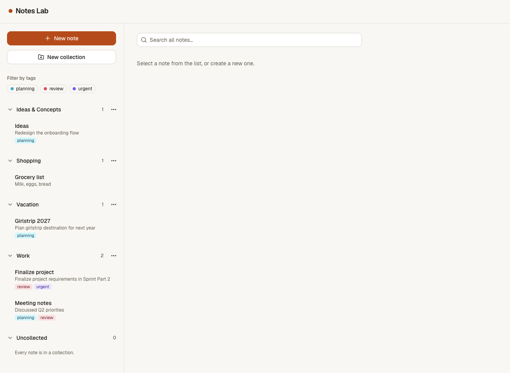

# Notes Lab

Notes Lab is a notes app. You sign in with your own account and only ever see your own notes. All data is stored in Supabase, so your notes are there on any device.

## Contents

- [What the app does](#what-the-app-does)
- [App option chosen](#app-option-chosen)
- [Run it locally](#run-it-locally)
- [Optional task: design](#optional-task-design)

## What the app does

- **Notes:** write, read, edit and delete notes.
- **Collections:** group notes into collections in the sidebar. Notes without a collection show up under "Uncollected".
- **Tags:** add tags to a note. Each tag has its own colour. The tag filter shows only notes that have all of the selected tags.
- **Search:** search the titles and text of all your notes. Results update while you type, and the tag filter still applies.
- **Clear messages:** when there is nothing to show (no notes, an empty collection, no search results), the app says so instead of showing a blank screen.
- **Accounts:** sign up, confirm your email, sign in and sign out.

## App option chosen

The notes app with collections, tags and search, built with Next.js, TypeScript, Tailwind CSS and Supabase.

## Run it locally

You need Node.js and a free Supabase project.

1. Install the packages:

   ```bash
   npm install
   ```

2. Create a file called `.env.local` in the project folder and add:

   ```env
   NEXT_PUBLIC_SUPABASE_URL=your-project-url
   NEXT_PUBLIC_SUPABASE_PUBLISHABLE_KEY=your-publishable-key
   SITE_URL=http://localhost:3000
   ```

   Where to find the values: open your project in the [Supabase dashboard](https://supabase.com/dashboard) and click **Connect** (or go to **Project Settings → API**). Copy the **Project URL** and the **publishable key** (the older **anon** key also works).

   `SITE_URL` is the address of the app itself. The sign-up confirmation email links back to it, so set it to the real address when the app is deployed. It has no `NEXT_PUBLIC_` prefix because only the server reads it.

3. Set up the database tables by linking your project and applying the migrations:

   ```bash
   npx supabase link
   npx supabase db push
   ```

   Before `db push` on a new project, turn on the Supabase setting that enables row-level security automatically for new tables. It creates the function `public.rls_auto_enable()`, which one of the migrations changes, so `db push` fails if the setting is off.

4. Start the app:

   ```bash
   npm run dev
   ```

   Then open [http://localhost:3000](http://localhost:3000) and create an account.

## Optional task: design

The optional task was a new design for the app. It was built on its own branch, `design`, and merged through pull request #7.

- A calm, warm look: off-white background, white cards and one orange accent colour for the main buttons and the selected note.
- Easy-to-read text with strong contrast.
- Works on phones, tablets and desktops. On a phone you see either the note list or the open note, with an "All notes" link to go back.
